# Jarkom-Modul-3-2026-K-64

| Nama | NRP |
|---|---|
| Mahrinza Redouane Zakariyah | 5027251074 |
| Dian Hanna Simanjuntak | 5027251116 |

## Reporting

## Modul 3

## Ringkasan Topologi dan Alamat

Topologi menggunakan satu router utama **Jichi** untuk menghubungkan jaringan DMZ, klien, dan pusat data. Server **Tengen** menangani DHCP, **Utahime** dan **Shoko** menangani DNS, sedangkan **Gojo** berperan sebagai reverse proxy layanan web/API. Pengujian benchmark dilakukan dari klien **Kusakabe**.

| Node/jaringan | IP / rentang | Peran |
|---|---|---|
| Jichi `eth0` | `192.168.122.134/24` (DHCP NAT, pada bukti) | Akses internet |
| Jichi `eth1` | `192.243.1.1/24` | Gateway DMZ |
| Jichi `eth2` | `192.243.2.1/24` | Gateway Network 2 |
| Jichi `eth3` | `192.243.3.1/24` | Gateway Network 3 |
| Jichi `eth4` | `192.243.4.1/24` | Gateway Network 4 |
| Tengen | `192.243.4.10/24` | DHCP server |
| Utahime | `192.243.1.2/24` | DNS master |
| Shoko | `192.243.1.3/24` | DNS slave |
| Gojo | `192.243.1.4/24` | Nginx reverse proxy |
| Kusakabe | IP DHCP di Network 3 | Klien benchmark dan verifikasi |

Domain yang digunakan adalah **`jujutsu.k64.com`**. Pada klien, DNS yang dikonfigurasi pada tahap akhir adalah `192.243.1.2` dan `192.243.1.3` dengan search domain `k64.com`.

---

## Soal 1 — Konfigurasi Routing dan Koneksi Antarsubnet

### Tujuan

Mengonfigurasi jaringan awal setiap node dan router Jichi agar antarjaringan saling terhubung serta dapat mengakses internet melalui NAT GNS3.

### Implementasi

Pada Jichi, antarmuka `eth0` memperoleh IP dari jaringan NAT, sedangkan `eth1`–`eth4` menjadi gateway untuk empat segmen internal. *IP forwarding* diaktifkan untuk memungkinkan paket diteruskan antarsubnet. NAT masquerading diterapkan pada antarmuka keluar `eth0` agar node internal dapat mengakses internet.

Perintah verifikasi yang digunakan:

```bash
ip -br -4 addr
ip route
cat /proc/sys/net/ipv4/ip_forward
iptables -t nat -L POSTROUTING -n -v
ping -c 4 8.8.8.8
```

Konfigurasi jaringan masing-masing server menggunakan script `/root/soal_1.sh`. Contohnya Tengen pada `192.243.4.10/24` dapat menghubungi gateway `192.243.4.1`, sementara Utahime berhasil mengakses internet.

### Hasil dan analisis

Dari pengujian Jichi, terlihat seluruh antarmuka internal memiliki alamat sesuai subnet dan *default route* mengarah ke `192.168.122.1`. Nilai `ip_forward` adalah `1` dan tabel NAT memuat aturan `MASQUERADE` melalui `eth0`. Ping ke `8.8.8.8` berhasil tanpa kehilangan paket. Konektivitas Tengen ke gateway serta konektivitas internet Utahime juga berhasil.

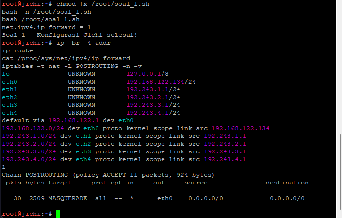

*Gambar 1.1. Status IP forwarding, NAT masquerade, serta ping internet pada Jichi.*

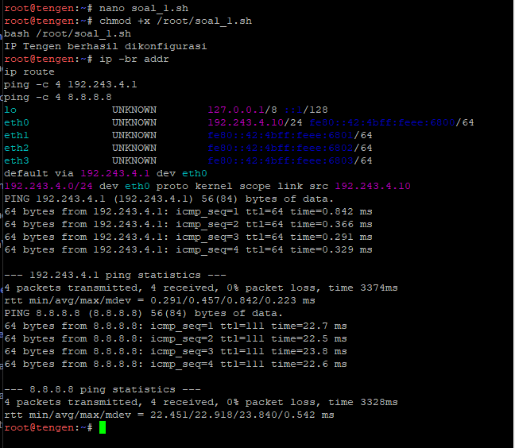

*Gambar 1.2. Antarmuka Jichi, routing table, dan konfigurasi NAT setelah menjalankan script Soal 1.*

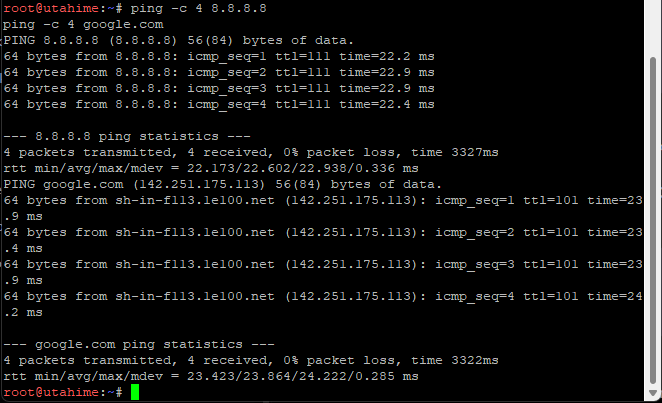

*Gambar 1.3. Verifikasi alamat Tengen, koneksi gateway, dan akses internet Utahime.*

**Kesimpulan:** Routing internal, akses internet, dan NAT di Jichi berhasil diterapkan serta diverifikasi.

---

## Soal 2 — Konfigurasi Awal DHCP Server pada Tengen

### Tujuan

Memasang dan mengonfigurasi layanan DHCP pada Tengen agar klien di jaringan terkait dapat menerima IP secara otomatis.

### Implementasi

Server DHCP dijalankan pada **Tengen** (`192.243.4.10`). Konfigurasi awal ditulis di `/etc/dhcp/dhcpd.conf`, kemudian validasi dilakukan menggunakan:

```bash
dhcpd -4 -t -cf /etc/dhcp/dhcpd.conf
service isc-dhcp-server status
cat /etc/dhcp/dhcpd.conf
```

Pada bukti tahap awal, Tengen telah mendefinisikan subnet Network 4 sebagai subnet lokal tanpa *pool*, serta pool awal pada Network 2 dan Network 3. Rentang dan opsi dari konfigurasi awal ini **masih mengalami penyesuaian dalam soal-soal DHCP berikutnya**, sehingga tidak digunakan sebagai acuan akhir pembagian kelas atau lease klien.

### Hasil dan analisis

Pemeriksaan sintaks `dhcpd -4 -t` tidak menampilkan kesalahan konfigurasi. Status layanan menunjukkan `dhcpd is running`, menandakan server DHCP berhasil diaktifkan.

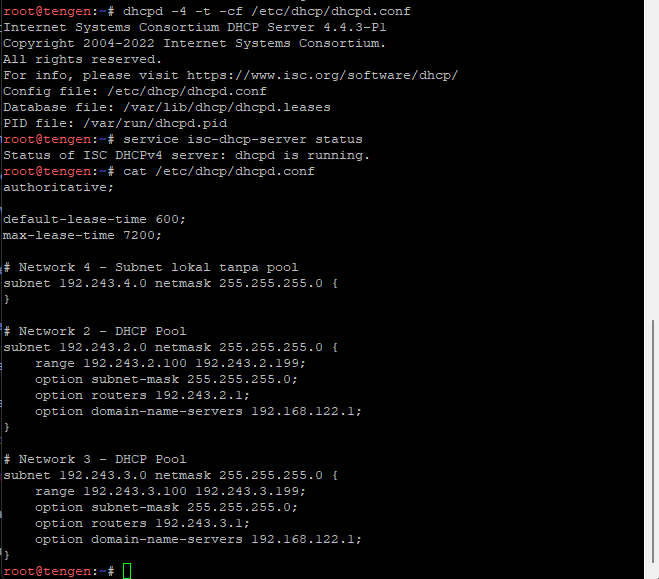

*Gambar 2.1. Konfigurasi awal subnet dan pool, validasi syntax DHCP, serta status DHCP server yang berjalan.*

**Kesimpulan:** Layanan DHCP pada Tengen berhasil dipasang dan dijalankan sebagai dasar distribusi alamat IP klien.

---

## Soal 3 — DHCP Relay

### Penjelasan
DHCP Relay meneruskan permintaan DHCP dari klien pada subnet yang berbeda menuju DHCP server Tengen (`192.243.4.10`). Karena broadcast DHCP tidak melewati router secara langsung, Jichi dipasangi `isc-dhcp-relay` agar permintaan dari Network 2 dan Network 3 dapat mencapai Tengen.

### Konfigurasi
Pada node Jichi, pasang paket relay dan tentukan alamat server serta antarmuka yang menerima permintaan klien.

```bash
apt-get update
apt-get install -y isc-dhcp-relay
```

Isi `/etc/default/isc-dhcp-relay`:

```bash
SERVERS="192.243.4.10"
INTERFACES="eth2 eth3 eth4"
OPTIONS=""
```

- `SERVERS` menentukan DHCP server tujuan, yaitu Tengen.
- `INTERFACES` menentukan antarmuka yang dilayani relay. `eth2` dan `eth3` digunakan untuk meneruskan permintaan dari Network 2 dan Network 3; `eth4` juga dicantumkan pada konfigurasi node relay.
- `OPTIONS` dibiarkan kosong karena tidak membutuhkan opsi tambahan.

Terapkan konfigurasi:

```bash
service isc-dhcp-relay restart
service isc-dhcp-relay status
```

### Pengujian dan analisis
Pada klien Network 2 dan Network 3, minta alamat DHCP lalu periksa alamat yang diperoleh:

```bash
ip -4 addr show
ip route
```

Alamat yang didapat harus berasal dari pool subnet klien masing-masing. Jika klien dari kedua subnet mendapatkan lease dari Tengen, berarti relay meneruskan permintaan ke server yang benar.

### Dokumentasi
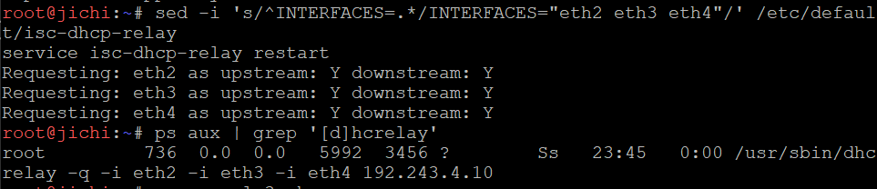  
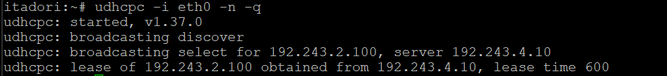  
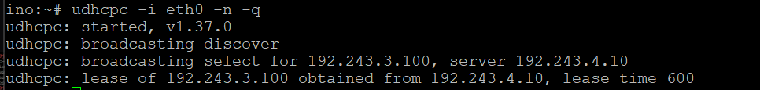  

---

## Soal 4 — DHCP Class dan Pembagian Pool Network 2

### Penjelasan
Tengen membagi alamat DHCP Network 2 menjadi dua pool berdasarkan MAC address. Itadori dan Fushiguro masuk kelas `dev`, sedangkan Zenin dan Okkotsu masuk kelas `support`. Pembagian kelas mencegah klien memperoleh alamat dari pool yang tidak diperuntukkan baginya.

### Konfigurasi
Konfigurasi DHCP diletakkan pada `/etc/dhcp/dhcpd.conf` di Tengen. Deklarasi kelasnya:

```conf
class "dev" {
    match if
        hardware = 1:02:42:ef:7f:1a:00 or
        hardware = 1:02:42:d2:a0:1a:00;
}

class "support" {
    match if
        hardware = 1:02:42:7e:e8:3a:00 or
        hardware = 1:02:42:0c:15:70:00;
}
```

- `class` membuat kelompok klien DHCP.
- `hardware` mencocokkan MAC address klien.
- `or` membuat salah satu dari dua MAC address dapat masuk ke kelas tersebut.

Pool Network 2:

```conf
subnet 192.243.2.0 netmask 255.255.255.0 {
    option subnet-mask 255.255.255.0;
    option routers 192.243.2.1;
    option domain-name-servers 192.168.122.1;

    pool {
        range 192.243.2.10 192.243.2.35;
        allow members of "dev";
    }

    pool {
        range 192.243.2.70 192.243.2.95;
        allow members of "support";
    }
}
```

Pool pertama menyediakan alamat `192.243.2.10–192.243.2.35` khusus kelas `dev`. Pool kedua menyediakan `192.243.2.70–192.243.2.95` untuk kelas `support`. Rentang `192.243.2.36–192.243.2.69` tidak dimasukkan ke pool sehingga tidak dibagikan oleh kedua pool ini.

Validasi dan terapkan konfigurasi:

```bash
dhcpd -t -4 -cf /etc/dhcp/dhcpd.conf
service isc-dhcp-server restart
```

`dhcpd -t` memeriksa sintaks konfigurasi sebelum layanan direstart.

### Pengujian dan analisis
Pada setiap klien, periksa MAC address dan lease:

```bash
ip link show
ip -4 addr show
```

Itadori dan Fushiguro seharusnya memperoleh alamat di rentang `.2.10–.2.35`, sedangkan Zenin dan Okkotsu memperoleh alamat di rentang `.2.70–.2.95`. Pembuktian utama adalah kecocokan alamat lease dengan kelas MAC address klien.

### Dokumentasi
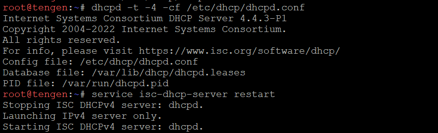  
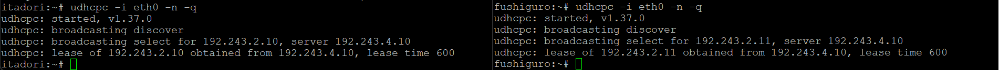  
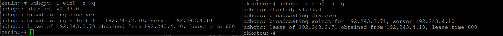  
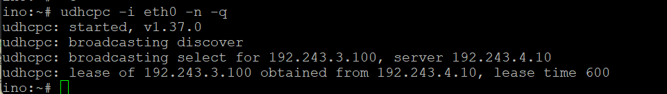  

---

## Soal 5 — Lease Pendek, Lease Panjang, DNS, dan Domain Network 3

### Penjelasan
Network 3 menggunakan dua kelompok klien dengan durasi lease berbeda. Ino dan Kusakabe memperoleh lease 30 menit (1800 detik), sedangkan Miwa memperoleh lease 12 jam (43200 detik). DHCP juga membagikan DNS server Utahime dan Shoko serta domain pencarian `k64.com`.

### Konfigurasi
Kelas klien ditentukan menggunakan MAC address:

```conf
class "short-lease" {
    match if
        hardware = 1:02:42:30:30:8f:00 or
        hardware = 1:02:42:16:89:27:00;
}

class "long-lease" {
    match if hardware = 1:02:42:cd:10:0d:00;
}
```

Pengaturan subnet dan pool Network 3:

```conf
subnet 192.243.3.0 netmask 255.255.255.0 {
    option subnet-mask 255.255.255.0;
    option routers 192.243.3.1;
    option domain-name-servers 192.243.1.2, 192.243.1.3;
    option domain-name "k64.com";
    option domain-search "k64.com";

    pool {
        range 192.243.3.10 192.243.3.89;
        default-lease-time 1800;
        max-lease-time 1800;
        allow members of "short-lease";
    }

    pool {
        range 192.243.3.100 192.243.3.199;
        default-lease-time 43200;
        max-lease-time 43200;
        allow members of "long-lease";
    }
}
```

`default-lease-time` menetapkan durasi lease standar, sedangkan `max-lease-time` menetapkan durasi maksimum. Nilai `1800` setara 30 menit dan `43200` setara 12 jam. Opsi DNS membagikan `192.243.1.2` dan `192.243.1.3`, sementara `domain-search` menetapkan akhiran domain yang digunakan saat pencarian nama.

Setelah konfigurasi ditulis, validasi dan restart DHCP server:

```bash
dhcpd -t -4 -cf /etc/dhcp/dhcpd.conf
service isc-dhcp-server restart
```

### Pengujian dan analisis
Pada Ino, Kusakabe, dan Miwa:

```bash
ip -4 addr show
cat /etc/resolv.conf
```

Jika lease details tersedia pada klien, periksa nilai `lease time`. Ino dan Kusakabe harus berada pada rentang `.3.10–.3.89` dengan lease 1800 detik; Miwa harus berada pada rentang `.3.100–.3.199` dengan lease 43200 detik. `resolv.conf` digunakan untuk memeriksa DNS yang diterima klien.

### Dokumentasi
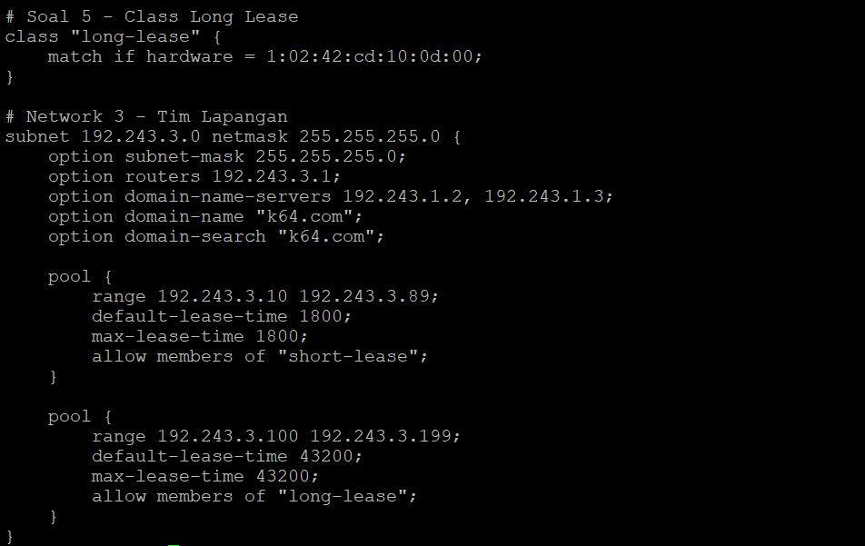  
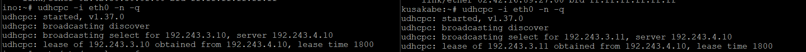  
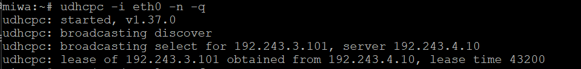   
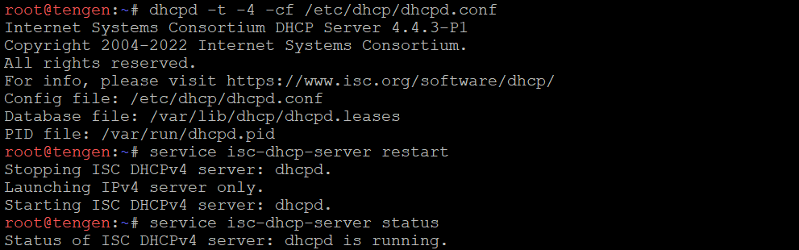  
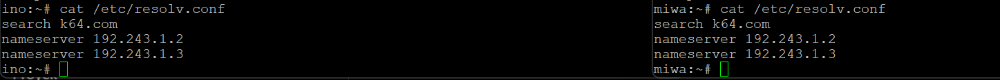 

---

## Soal 6 — DHCP Static Lease untuk Kugisaki

### Penjelasan
Kugisaki membutuhkan alamat tetap `192.243.3.99` berdasarkan MAC address. Alamat tersebut berada di luar pool dinamis Network 3 (`.3.10–.3.89` dan `.3.100–.3.199`) sehingga tidak bertabrakan dengan lease dinamis.

### Konfigurasi
Tambahkan reservasi berikut pada `/etc/dhcp/dhcpd.conf` di Tengen:

```conf
host kugisaki {
    hardware ethernet 02:42:75:3d:8f:00;
    fixed-address 192.243.3.99;
}
```

- `host kugisaki` memberi nama pada deklarasi klien.
- `hardware ethernet` mengikat reservasi ke MAC address Kugisaki.
- `fixed-address` menentukan alamat tetap yang akan diberikan kepada klien tersebut.

Validasi dan terapkan konfigurasi:

```bash
dhcpd -t -4 -cf /etc/dhcp/dhcpd.conf
service isc-dhcp-server restart
```

Pada Kugisaki, minta lease baru dan periksa alamatnya:

```bash
dhclient -r
dhclient
ip -4 addr show
```

`dhclient -r` melepas lease yang sedang digunakan; `dhclient` meminta lease kembali dari DHCP server.

### Pengujian dan analisis
Kugisaki harus memperoleh `192.243.3.99` secara konsisten. Hasil tersebut membuktikan server mencocokkan MAC address klien dengan reservasi, bukan memberikan alamat dari pool dinamis.

### Dokumentasi
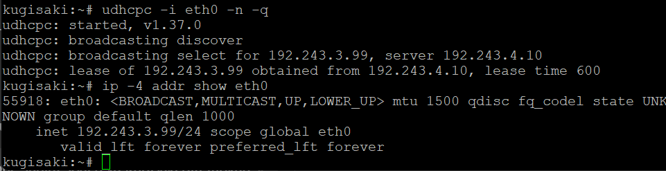  
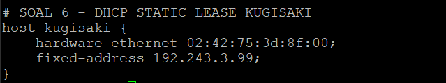  
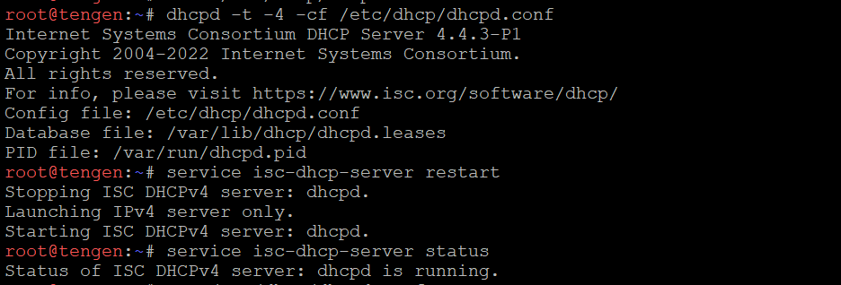  

---

## Soal 7 — Verifikasi DHCP Client pada Network 2 dan Network 3

### Tujuan

Memverifikasi bahwa para klien menerima alamat IP, subnet mask, gateway, serta DNS sesuai kebijakan DHCP yang telah disiapkan.

### Implementasi

Pada klien berbasis Alpine, pembaruan lease DHCP dilakukan dengan `udhcpc`. Pemeriksaan yang dilakukan mencakup:

```sh
udhcpc -i eth0 -n -q
ip -4 addr show eth0
ip route
cat /etc/resolv.conf
nslookup ns1.jujutsu.k64.com 192.243.1.2
nslookup ns1.jujutsu.k64.com 192.243.1.3
```

Pemeriksaan dilakukan pada delapan klien: Itadori, Fushiguro, Zenin, Okkotsu, Ino, Kusakabe, Miwa, dan Kugisaki.

### Hasil verifikasi

Berikut adalah contoh hasil alamat yang tampak dalam screenshot verifikasi. IP dinamis dapat berbeda setelah lease diperbarui.

| Klien | IP pada bukti | Gateway | Keterangan |
|---|---|---|---|
| Itadori | `192.243.2.10` | `192.243.2.1` | Pool developer |
| Fushiguro | `192.243.2.11` | `192.243.2.1` | Pool developer |
| Zenin | `192.243.2.70` | `192.243.2.1` | Pool support |
| Okkotsu | `192.243.2.71` | `192.243.2.1` | Pool support |
| Ino | `192.243.3.11` | `192.243.3.1` | Lease singkat (1800 detik) |
| Kusakabe | `192.243.3.10` | `192.243.3.1` | Lease singkat; alamat yang terlihat pada bukti |
| Miwa | `192.243.3.100` | `192.243.3.1` | Lease panjang (43200 detik pada konfigurasi) |
| Kugisaki | `192.243.3.99` | `192.243.3.1` | Reservasi DHCP berdasarkan MAC |

Semua klien menggunakan mask `/24` dan DNS `192.243.1.2` serta `192.243.1.3`. Hasil `nslookup` pada kedua DNS mengarah ke record `ns1.jujutsu.k64.com` dengan alamat `192.243.1.2`.

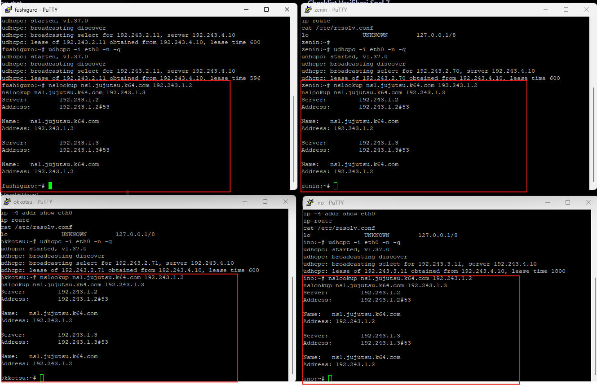

*Gambar 7.1. Contoh perolehan lease DHCP dan pemeriksaan DNS Fushiguro, Zenin, Okkotsu, dan Ino.*

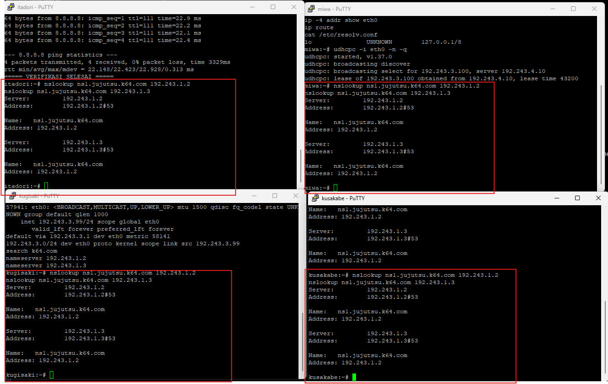

*Gambar 7.2. Verifikasi alamat serta resolusi DNS Itadori, Miwa, Kugisaki, dan Kusakabe.*

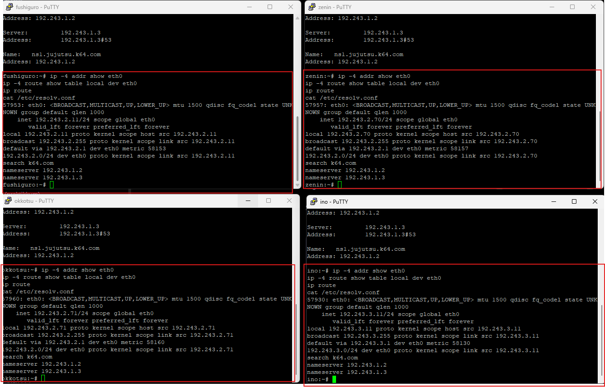

*Gambar 7.3. Pemeriksaan konfigurasi jaringan klien Network 2 serta Ino.*

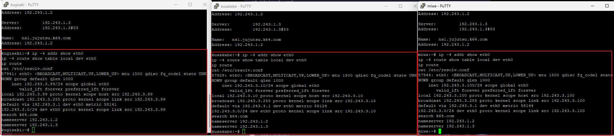

*Gambar 7.4. Pemeriksaan konfigurasi Kugisaki, Kusakabe, dan Miwa.*

**Kesimpulan:** Pembagian IP DHCP, gateway, DNS, serta kebijakan IP tetap untuk Kugisaki telah terverifikasi pada klien yang diuji.

---

## Soal 8 — Analisis Proses DHCP dengan Packet Capture

### Tujuan

Mengamati alur pertukaran paket DHCP menggunakan `tcpdump`, mengidentifikasi tahapan **DORA** (*Discover, Offer, Request, Acknowledge*), dan memeriksa informasi jaringan yang dikirimkan server.

### Implementasi

Paket DHCP direkam dari sisi Tengen dan disimpan sebagai `/root/soal_8.pcap`. Berkas capture dibaca dengan `tcpdump` untuk menampilkan jenis pesan DHCP dan *options* relevan.

Contoh perintah analisis yang digunakan:

```bash
tcpdump -nn -vvv -r /root/soal_8.pcap 2>/dev/null | grep 'DHCP-Message'
tcpdump -nn -vvv -r /root/soal_8.pcap 2>/dev/null | grep -E 'Gateway-IP|Your-IP|Server-ID|Lease-Time|Default-Gateway|Domain-Name-Server|DHCP-Message'
```

### Hasil dan analisis

Capture memperlihatkan urutan lengkap **Discover → Offer → Request → ACK** untuk klien **Ino**. DHCP Server teridentifikasi sebagai `192.243.4.10`, sedangkan alamat relai (*gateway IP / giaddr*) menunjukkan `192.243.3.1`. Klien memperoleh `192.243.3.11` dengan lease `1800` detik, gateway `192.243.3.1`, dan DNS `192.243.1.2` serta `192.243.1.3`.

| Field DHCP | Nilai hasil pengamatan |
|---|---|
| DHCP Server ID | `192.243.4.10` |
| Relay/Gateway IP | `192.243.3.1` |
| Your IP Address | `192.243.3.11` |
| Lease Time | `1800` detik |
| Default Gateway | `192.243.3.1` |
| DNS Server | `192.243.1.2`, `192.243.1.3` |

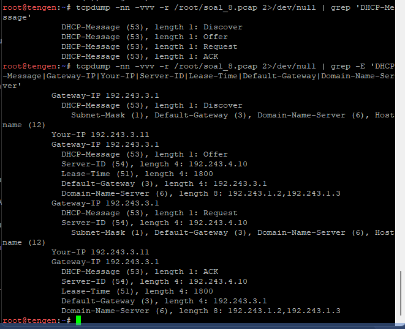

*Gambar 8.1. Empat tahapan pesan DHCP hasil packet capture.*

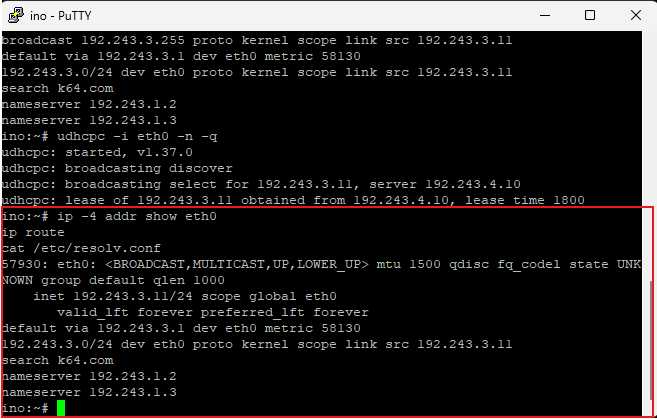

*Gambar 8.2. Server ID, alamat klien, IP relay, gateway, DNS, serta lease time dalam paket DHCP.*

**Kesimpulan:** DHCP DORA berhasil diamati secara lengkap dan data option sesuai dengan konfigurasi jaringan klien.

---

## Soal 9 — Troubleshooting Kegagalan DHCP Relay

### Tujuan

Membuktikan pengaruh layanan DHCP Relay Jichi terhadap kemampuan klien yang berbeda subnet dari Tengen untuk memperoleh lease DHCP.

### Implementasi

Pengujian dilakukan dengan menghentikan relay di Jichi lalu menghapus sementara IP serta default route Ino agar klien melakukan permintaan DHCP baru. Ketika relay tidak aktif, permintaan berulang dilakukan dengan `udhcpc`.

```bash
# Jichi: kendalikan relay
bash /root/soal_9.sh stop
# Ino: lepaskan alamat dan minta lease baru
ip -4 addr flush dev eth0
ip -4 route del default dev eth0 2>/dev/null || true
udhcpc -i eth0 -n -q -t 3 -T 2
```

Setelah simulasi gagal, layanan DHCP Relay dipulihkan:

```bash
# Jichi
bash /root/soal_9.sh start
# Ino
udhcpc -i eth0 -n -q
```

### Hasil dan analisis

Pada kondisi relay berhenti, permintaan DHCP dari Ino menghasilkan **`no lease, failing`**. Ketika relay Jichi dinyalakan kembali, server `192.243.4.10` memberikan lease `192.243.3.11` selama `1800` detik. Gateway kembali terisi `192.243.3.1`.

Kegagalan tersebut konsisten dengan fungsi DHCP Relay: broadcast DHCP dari Network 3 tidak otomatis menyeberangi router tanpa bantuan relay.

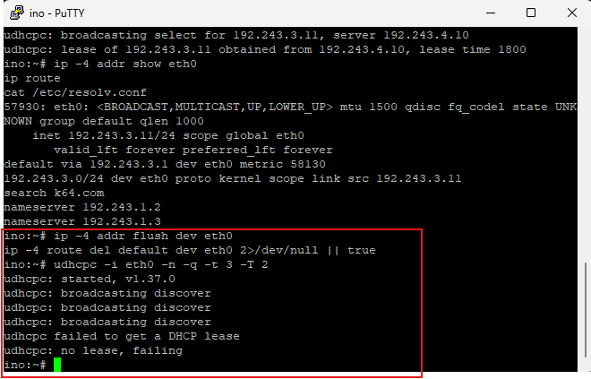

*Gambar 9.1. Kondisi alamat dan DNS Ino sebelum simulasi DHCP Relay mati.*

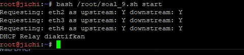

*Gambar 9.2. Pemulihan layanan DHCP Relay menggunakan script Soal 9.*

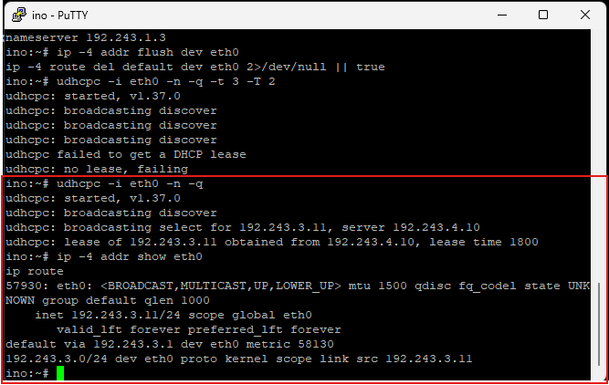

*Gambar 9.3. Perbandingan permintaan DHCP sebelum dan sesudah DHCP Relay dipulihkan.*

**Kesimpulan:** Gangguan DHCP pada klien lintas subnet berhasil direproduksi dan diatasi melalui pemulihan DHCP Relay.

---

## Soal 10 — Autorecovery Konfigurasi Jaringan dan DHCP

### Tujuan

Mengotomatisasi pemulihan konfigurasi routing dan layanan DHCP setelah node Jichi atau Tengen direstart, sehingga layanan tidak perlu diaktifkan secara manual setiap kali container hidup kembali.

### Implementasi

Script `/root/soal_10.sh` dibuat pada **Jichi** dan **Tengen**, kemudian dipanggil melalui `/root/init.sh` yang dapat dijalankan oleh mekanisme inisialisasi container DebiNet. Pada Jichi, pemulihan mencakup IP interface, `ip_forward`, NAT, dan DHCP Relay. Pada Tengen, pemulihan mencakup IP server serta layanan DHCP.

Pengujian dilakukan dengan me-restart kedua node secara terpisah dan memeriksa konfigurasi setelah node kembali aktif.

Contoh perintah verifikasi:

```bash
cat /root/soal_10.log
ip -br -4 addr
ip route
cat /proc/sys/net/ipv4/ip_forward
iptables -t nat -L POSTROUTING -n -v
service isc-dhcp-relay status
# Di masing-masing klien:
udhcpc -i eth0 -n -q
```

### Hasil dan analisis

Log inisialisasi Jichi memperlihatkan pemulihan IP `eth0` melalui DHCP, status forwarding, dan konfigurasi relay. Setelah restart, IP Jichi untuk Network 1–4 tetap sesuai dan default route kembali tersedia. Di Tengen, log pemulihan memperlihatkan pemanggilan konfigurasi DHCP, pembaruan reservasi Kugisaki, dan status layanan `dhcpd is running`. Validasi `dhcpd -4 -t` berhasil; kelas/pool DHCP dan alamat DNS juga kembali ada pada konfigurasi. Uji DHCP pada Itadori, Zenin, Ino, Miwa, dan Kugisaki menunjukkan server Tengen kembali melayani permintaan; Kugisaki tetap memperoleh alamat reservasi `192.243.3.99`.

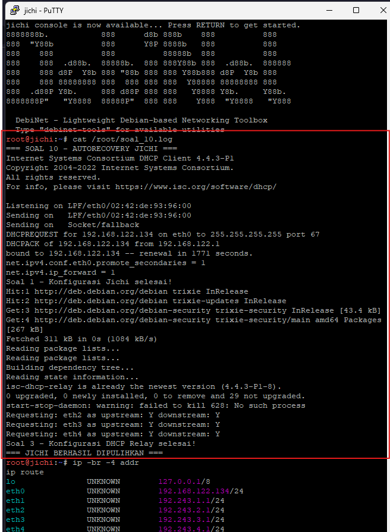

*Gambar 10.1. Log pemulihan konfigurasi jaringan, IP forwarding, dan layanan DHCP Relay pada Jichi.*

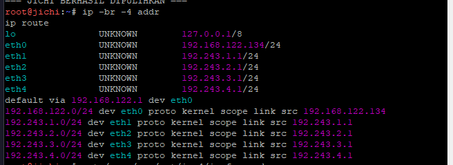

*Gambar 10.2. Alamat antarmuka serta tabel rute Jichi setelah container diaktifkan kembali.*

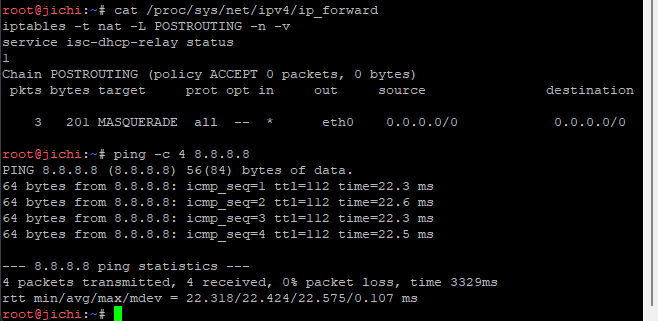

*Gambar 10.3. Bukti nilai `ip_forward=1`, aturan NAT masquerade, serta konektivitas internet Jichi.*

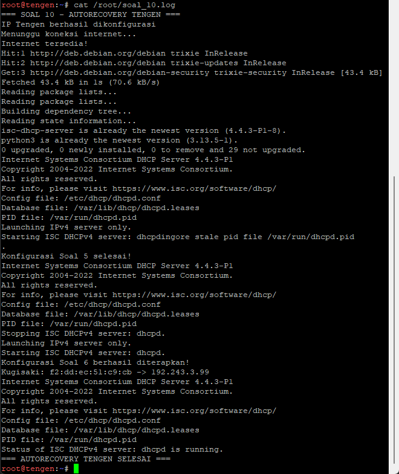

*Gambar 10.4. Log `/root/soal_10.log` menunjukkan tahapan pemulihan DHCP Server, konfigurasi pool, dan reservasi Kugisaki pada Tengen.*

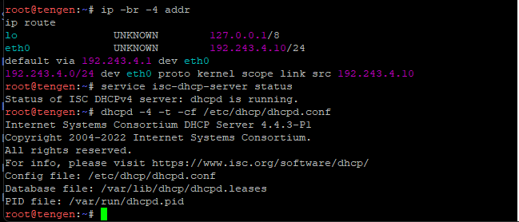

*Gambar 10.5. IP Tengen `192.243.4.10/24`, layanan `dhcpd is running`, dan validasi konfigurasi DHCP.*

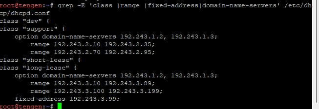

*Gambar 10.6. Pemeriksaan kelas dev, support, short-lease, long-lease, alamat DNS, rentang pool, serta `fixed-address` pada `dhcpd.conf`.*

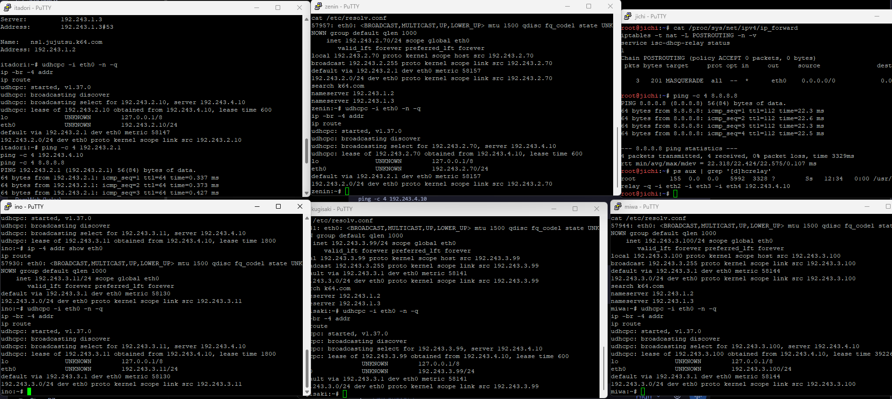

*Gambar 10.7. Pengujian ulang DHCP pada Itadori, Zenin, Ino, Kugisaki, Miwa, dan status DHCP Relay Jichi.*

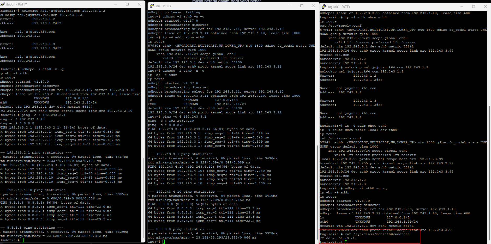

*Gambar 10.8. Verifikasi komunikasi antarjaringan, DNS klien, serta identitas MAC address yang digunakan oleh reservasi Kugisaki.*

**Kesimpulan:** Autorecovery Jichi dan Tengen bekerja pada pengujian restart yang dilakukan. Cakupan otomasi ini hanya kedua node tersebut; server lain yang ter-reset tidak otomatis ikut dipulihkan.

---

## Soal 11 — Konfigurasi DNS Master dan DNS Slave

### Tujuan

Membangun DNS *authoritative* untuk zona **`jujutsu.k64.com`** dengan **Utahime** sebagai DNS Master dan **Shoko** sebagai DNS Slave. Mekanisme transfer zona digunakan agar perubahan pada master dapat tersinkronisasi ke slave.

### Implementasi

BIND9 dikonfigurasi pada Utahime (`192.243.1.2`) dan Shoko (`192.243.1.3`) menggunakan script `/root/soal_11.sh` pada masing-masing node. Zona master disimpan dalam `/etc/bind/db.jujutsu.k64.com`, sedangkan berkas hasil transfer zona slave berada pada `/var/cache/bind/db.jujutsu.k64.com`. Akses transfer dari master dibatasi ke alamat IP Shoko.

Potongan konfigurasi DNS Master di Utahime:

```conf
zone "jujutsu.k64.com" {
    type master;
    file "/etc/bind/db.jujutsu.k64.com";
    allow-transfer { 192.243.1.3; };
    also-notify { 192.243.1.3; };
    notify yes;
};
```

Potongan konfigurasi DNS Slave di Shoko:

```conf
zone "jujutsu.k64.com" {
    type slave;
    file "/var/cache/bind/db.jujutsu.k64.com";
    masters { 192.243.1.2; };
    allow-notify { 192.243.1.2; };
};
```

Zona memiliki NS `ns1.jujutsu.k64.com` (`192.243.1.2`) dan `ns2.jujutsu.k64.com` (`192.243.1.3`). Validasi konfigurasi dilakukan menggunakan `named-checkconf` dan `named-checkzone`, disusul pengujian query langsung ke masing-masing server DNS.

```bash
# Pada Utahime
named-checkconf
named-checkzone jujutsu.k64.com /etc/bind/db.jujutsu.k64.com
service named status

dig @192.243.1.2 ns1.jujutsu.k64.com A +short
dig @192.243.1.2 jujutsu.k64.com SOA +short

# Validasi dari sisi Slave
dig @192.243.1.3 ns1.jujutsu.k64.com A +short
dig @192.243.1.3 jujutsu.k64.com SOA +short
```

### Pengujian dan hasil

Pengujian awal menunjukkan `bind is running` pada kedua server. Resolusi record `ns1.jujutsu.k64.com` melalui master dan slave sama-sama menghasilkan alamat **`192.243.1.2`**. Pada pemeriksaan SOA awal, master dan slave sama-sama menampilkan serial `2026101401`.

Selanjutnya, serial zona di Utahime dinaikkan dari **`2026101401` menjadi `2026101402`** lalu dilakukan `rndc reload jujutsu.k64.com`. Setelah reload, query SOA dari master (`192.243.1.2`) dan slave (`192.243.1.3`) menunjukkan **serial yang sama, `2026101402`**. Kesesuaian serial tersebut menjadi bukti bahwa perubahan zona telah tersinkronisasi dari Utahime ke Shoko pada saat pengujian.

| Pengujian | Hasil pengamatan |
|---|---|
| Layanan BIND9 Utahime | `bind is running` |
| Layanan BIND9 Shoko | `bind is running` |
| A record `ns1` via Utahime | `192.243.1.2` |
| A record `ns1` via Shoko | `192.243.1.2` |
| Serial SOA sebelum pembaruan | `2026101401` pada master dan slave |
| Serial SOA setelah pembaruan | **`2026101402`** pada master dan slave |

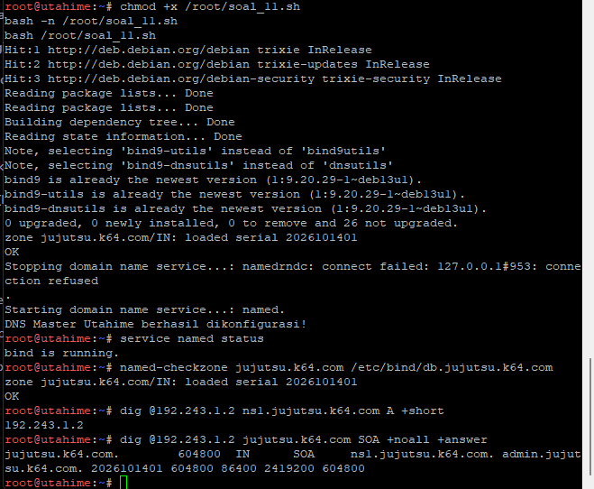

*Gambar 11.1. Script DNS Master dijalankan pada Utahime, layanan BIND aktif, sintaks zona valid, dan query A/SOA dapat dijawab.*

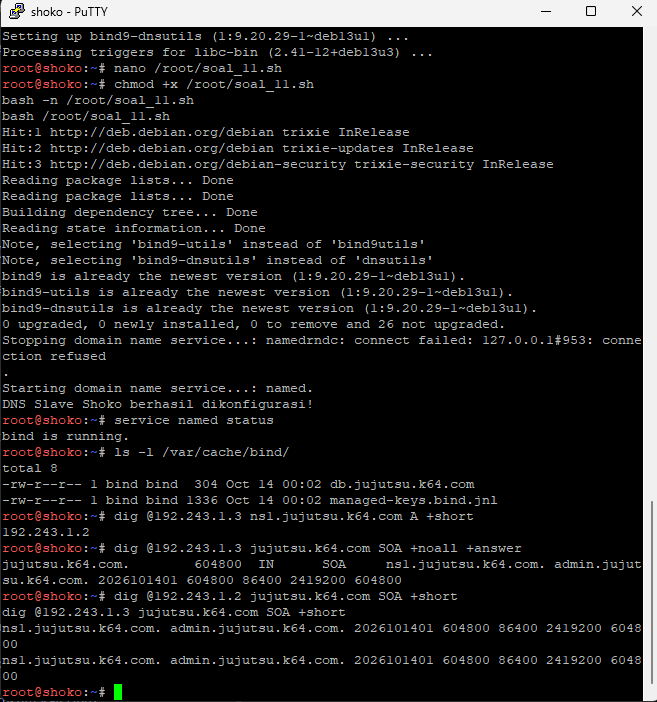

*Gambar 11.2. Layanan DNS Slave aktif, file transfer zona tersedia pada `/var/cache/bind/`, serta query A dan SOA berhasil.*

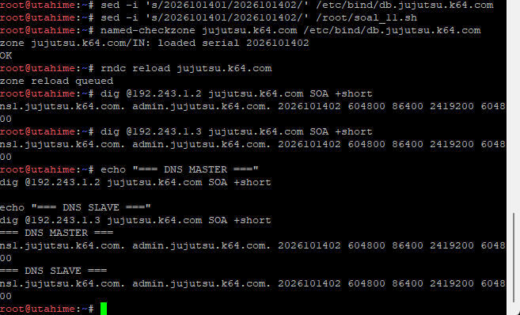

*Gambar 11.3. Setelah serial zona dinaikkan ke `2026101402` dan zona dimuat ulang, master dan slave menampilkan serial SOA yang sama.*

**Kesimpulan:** Konfigurasi DNS Master–Slave berhasil dijalankan dan sinkronisasi transfer zona dibuktikan dengan perubahan serial SOA dari `2026101401` menjadi `2026101402` pada kedua server. Bukti ini berasal dari sesi pengujian saat layanan BIND berjalan; tidak dimaksudkan sebagai bukti bahwa layanan tetap aktif setelah restart container di sesi berbeda.

---

## Soal 12 — DNS A, CNAME, PTR, dan Forwarder

### Penjelasan
Utahime dikonfigurasi sebagai DNS master untuk zona `jujutsu.k64.com`. Record A mengarahkan domain utama ke Gojo (`192.243.1.4`), CNAME membuat alias `www`, dan PTR memungkinkan pencarian balik alamat IP Gojo menjadi nama domain. DNS forwarder `192.168.122.1` digunakan untuk meneruskan kueri domain eksternal.

### Konfigurasi
Pasang perangkat DNS dan utilitas pemeriksaan:

```bash
apt-get install -y bind9 bind9-utils dnsutils
```

Konfigurasi zona forward di `/etc/bind/named.conf.local`:

```conf
zone "jujutsu.k64.com" {
    type master;
    file "/etc/bind/db.jujutsu.k64.com";
    allow-transfer { 192.243.1.3; };
    also-notify { 192.243.1.3; };
    notify yes;
};

zone "1.243.192.in-addr.arpa" {
    type master;
    file "/etc/bind/db.192.243.1";
    allow-transfer { 192.243.1.3; };
    also-notify { 192.243.1.3; };
    notify yes;
};
```

Isi penting zona forward `/etc/bind/db.jujutsu.k64.com`:

```dns
@    IN NS    ns1.jujutsu.k64.com.
@    IN NS    ns2.jujutsu.k64.com.
ns1  IN A     192.243.1.2
ns2  IN A     192.243.1.3
@    IN A     192.243.1.4
www  IN CNAME jujutsu.k64.com.
```

Record A menghubungkan nama dengan alamat IPv4, sedangkan CNAME membuat `www.jujutsu.k64.com` menjadi alias domain utama. Pada zona reverse `/etc/bind/db.192.243.1`, record berikut memetakan alamat Gojo:

```dns
4 IN PTR jujutsu.k64.com.
```

Tambahkan forwarder pada `/etc/bind/named.conf.options`:

```conf
options {
    directory "/var/cache/bind";
    recursion yes;
    allow-query { any; };
    allow-recursion { any; };
    forwarders {
        192.168.122.1;
    };
    dnssec-validation auto;
};
```

Validasi konfigurasi dan zona, lalu restart DNS:

```bash
named-checkconf
named-checkzone jujutsu.k64.com /etc/bind/db.jujutsu.k64.com
named-checkzone 1.243.192.in-addr.arpa /etc/bind/db.192.243.1
service named restart
```

### Pengujian dan analisis
Jalankan kueri DNS dari klien yang menggunakan Utahime:

```bash
dig @192.243.1.2 jujutsu.k64.com A
dig @192.243.1.2 www.jujutsu.k64.com CNAME
dig @192.243.1.2 -x 192.243.1.4
dig @192.243.1.2 google.com
ping -c 4 google.com
```

Kueri pertama harus menghasilkan A record `192.243.1.4`; kueri kedua menampilkan alias CNAME; kueri PTR mengembalikan `jujutsu.k64.com`; dan kueri `google.com` menguji penerusan kueri DNS eksternal.

### Dokumentasi
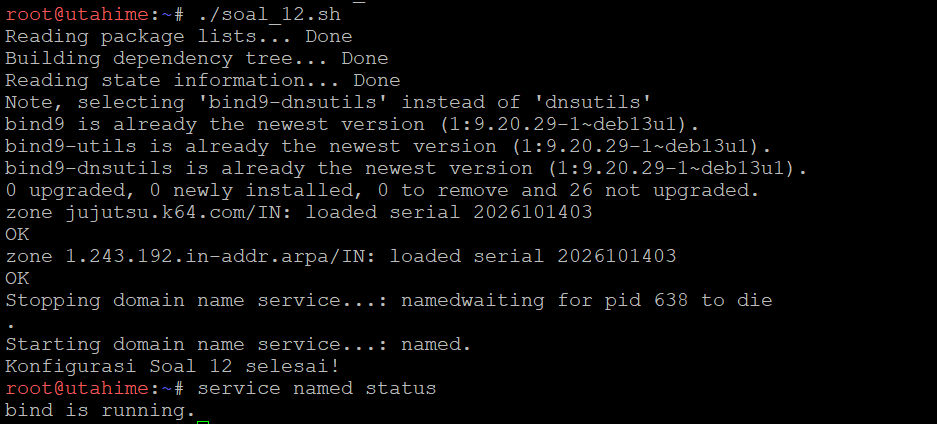  
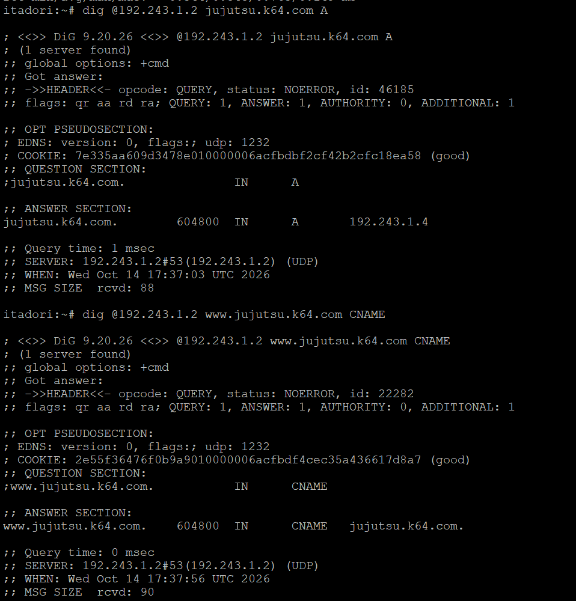  
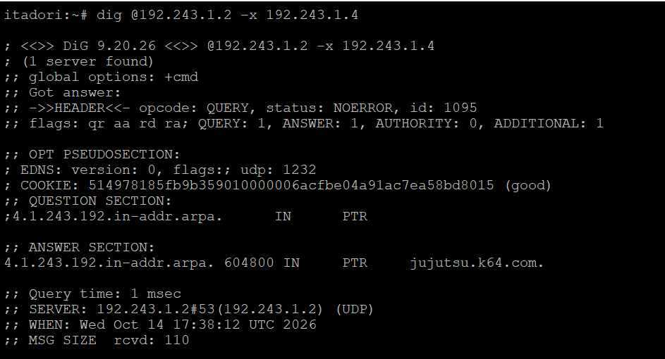  
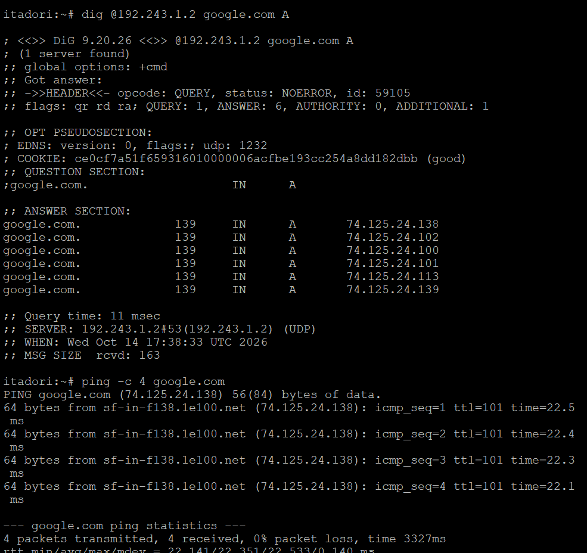  

---

## Soal 13 — MariaDB Master-Slave pada Yaga dan Inumaki

### Penjelasan
Yaga (`192.243.4.17`) menjadi database master dan Inumaki (`192.243.4.18`) menjadi slave. Replikasi binary log menjaga agar perubahan pada tabel `request_logs` di master ikut diterapkan pada slave. Database yang digunakan adalah `db_shibuya_k64`.

### Konfigurasi master — Yaga
Pasang MariaDB, siapkan direktori log, lalu buat `/etc/mysql/mariadb.conf.d/60-replication.cnf`:

```ini
[mysqld]
server-id = 17
log_bin = /var/log/mysql/mariadb-bin
binlog_format = ROW
binlog_do_db = db_shibuya_k64
bind-address = 0.0.0.0
```

`server-id` harus unik untuk setiap node database. `log_bin` mengaktifkan binary log, `binlog_format = ROW` mencatat perubahan per baris, `binlog_do_db` menentukan database yang direplikasi, dan `bind-address = 0.0.0.0` memungkinkan koneksi melalui antarmuka jaringan.

Siapkan direktori log dan restart MariaDB:

```bash
mkdir -p /var/log/mysql
chown mysql:mysql /var/log/mysql
chmod 750 /var/log/mysql
service mariadb restart
```

Buat database, tabel, dan akun replikasi/aplikasi:

```sql
CREATE DATABASE IF NOT EXISTS db_shibuya_k64;

CREATE TABLE IF NOT EXISTS db_shibuya_k64.request_logs (
    id INT AUTO_INCREMENT PRIMARY KEY,
    client_ip VARCHAR(45) NOT NULL,
    request_path VARCHAR(255) NOT NULL,
    status_code INT NOT NULL,
    created_at TIMESTAMP DEFAULT CURRENT_TIMESTAMP
);

CREATE USER IF NOT EXISTS 'repl'@'192.243.4.18'
IDENTIFIED BY 'K64Repl2026!';
GRANT REPLICATION SLAVE ON *.* TO 'repl'@'192.243.4.18';

CREATE USER IF NOT EXISTS 'appuser'@'192.243.4.%'
IDENTIFIED BY 'K64App2026!';
GRANT ALL PRIVILEGES ON db_shibuya_k64.* TO 'appuser'@'192.243.4.%';
FLUSH PRIVILEGES;
```

Akun `repl` digunakan oleh Inumaki untuk membaca binary log master. Akun `appuser` digunakan aplikasi API untuk menulis log request ke database.

Periksa identitas dan posisi binary log master:

```sql
SHOW VARIABLES LIKE 'server_id';
SHOW VARIABLES LIKE 'log_bin';
SHOW MASTER STATUS\G
```

Catat nilai `File` dan `Position` dari `SHOW MASTER STATUS`; keduanya dipakai saat menghubungkan slave.

### Konfigurasi slave — Inumaki
Buat `/etc/mysql/mariadb.conf.d/60-replication.cnf`:

```ini
[mysqld]
server-id = 18
relay-log = /var/log/mysql/mariadb-relay-bin
read_only = ON
bind-address = 0.0.0.0
```

`server-id = 18` membedakan slave dari master. `relay-log` menyimpan event replikasi yang diterima, sedangkan `read_only = ON` membantu mencegah penulisan langsung ke slave.

Setelah MariaDB berjalan, jalankan perintah berikut pada Inumaki. Nilai file dan posisi harus sesuai dengan hasil `SHOW MASTER STATUS` dari Yaga:

```sql
STOP SLAVE;

CHANGE MASTER TO
    MASTER_HOST='192.243.4.17',
    MASTER_USER='repl',
    MASTER_PASSWORD='K64Repl2026!',
    MASTER_PORT=3306,
    MASTER_LOG_FILE='mariadb-bin.000001',
    MASTER_LOG_POS=330;

START SLAVE;
SHOW SLAVE STATUS\G
```

### Pengujian dan analisis
Pada Yaga, masukkan satu baris uji:

```sql
INSERT INTO db_shibuya_k64.request_logs
    (client_ip, request_path, status_code)
VALUES
    ('192.243.4.18', '/soal-13-test', 200);

SELECT * FROM db_shibuya_k64.request_logs;
```

Pada Inumaki, jalankan:

```sql
SHOW SLAVE STATUS\G
SELECT * FROM db_shibuya_k64.request_logs;
```

Status replikasi yang diharapkan adalah `Slave_IO_Running: Yes` dan `Slave_SQL_Running: Yes`. Baris `/soal-13-test` harus muncul di master dan slave. Hal ini menunjukkan event perubahan berhasil dikirim dan diterapkan.

### Dokumentasi
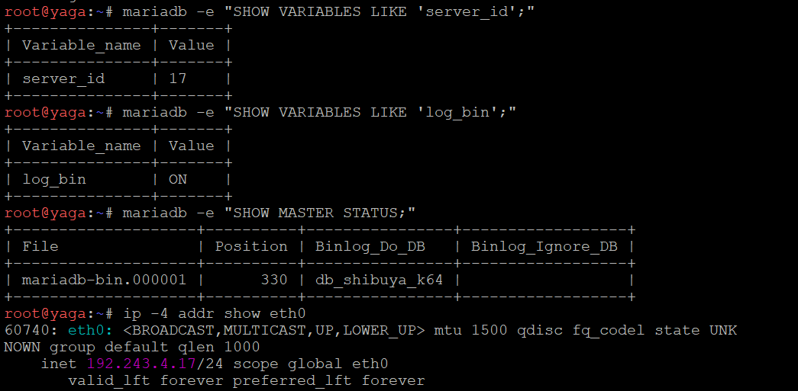  
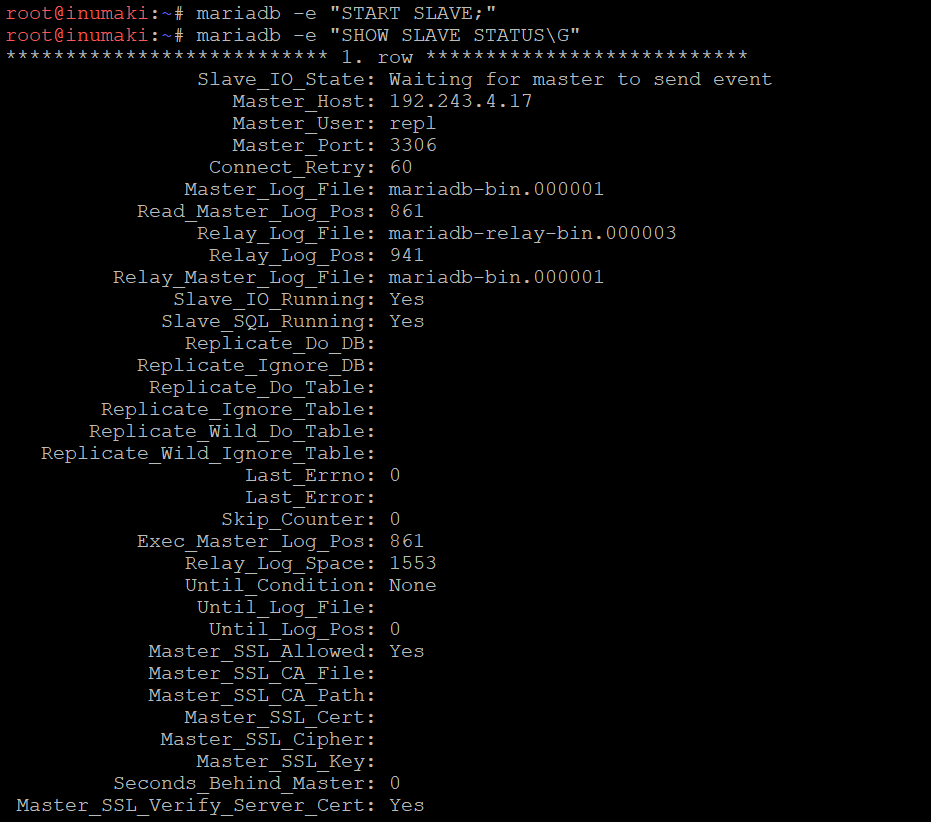  
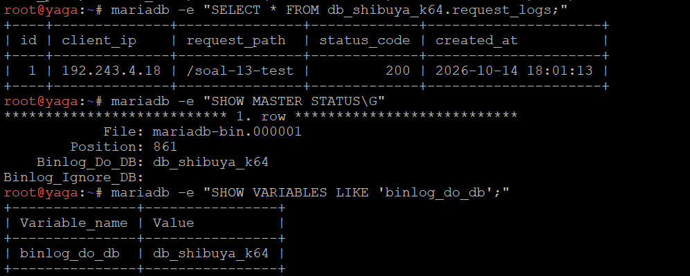  
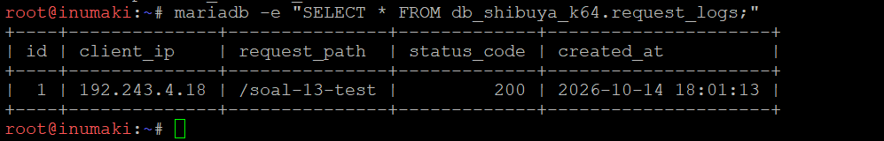  
---

## Soal 14 — Web Worker dan API Worker

### Penjelasan
Maki dan Panda menjadi web worker yang menyajikan halaman PHP berisi hostname server. Nanami, Todo, dan Kirara menjalankan API berbasis PHP yang mencatat setiap request ke database Yaga. Akses worker dibatasi: web worker hanya menerima koneksi dari Gojo, sedangkan API worker hanya menerima koneksi dari Geto.

### Konfigurasi web worker — Maki dan Panda
Pasang Nginx dan PHP-FPM:

```bash
apt-get update
apt-get install -y nginx php-fpm
```

Buat `/var/www/jujutsu/index.php`:

```php
<?php
header('Content-Type: text/html; charset=UTF-8');
echo '<h1>Jujutsu Kaisen Web Worker</h1>';
echo '<p>Hostname: ' . htmlspecialchars(gethostname(), ENT_QUOTES, 'UTF-8') . '</p>';
echo '<p>PHP-FPM aktif.</p>';
?>
```

`gethostname()` menampilkan identitas worker sehingga respons dari Maki dan Panda dapat dibedakan. `htmlspecialchars()` mengamankan teks hostname sebelum ditampilkan dalam HTML.

Virtual host Nginx pada worker:

```nginx
server {
    listen 80;
    server_name jujutsu.k64.com www.jujutsu.k64.com;

    root /var/www/jujutsu;
    index index.php index.html;

    allow 192.243.1.4;
    allow 127.0.0.1;
    deny all;

    location / {
        try_files $uri $uri/ /index.php?$query_string;
    }

    location ~ \.php$ {
        include snippets/fastcgi-php.conf;
        fastcgi_pass unix:/run/php/php8.4-fpm.sock;
    }
}
```

`allow` hanya mengizinkan Gojo dan localhost, sedangkan `deny all` menolak alamat lain. `fastcgi_pass` menghubungkan Nginx dengan PHP-FPM untuk memproses file PHP.

### Konfigurasi API worker — Nanami, Todo, dan Kirara
Pasang paket yang diperlukan:

```bash
apt-get update
apt-get install -y nginx php-fpm php-mysql
```

API menggunakan `/var/www/api/index.php` untuk membaca alamat/path request dan memasukkannya ke tabel `request_logs` pada Yaga:

```php
$clientIp = $_SERVER['REMOTE_ADDR'] ?? 'unknown';
$requestPath = $_SERVER['REQUEST_URI'] ?? '/';
$statusCode = 200;

$pdo = new PDO(
    'mysql:host=192.243.4.17;dbname=db_shibuya_k64;charset=utf8mb4',
    'appuser',
    'K64App2026!',
    [PDO::ATTR_ERRMODE => PDO::ERRMODE_EXCEPTION]
);

$stmt = $pdo->prepare(
    'INSERT INTO request_logs (client_ip, request_path, status_code)
     VALUES (?, ?, ?)'
);
$stmt->execute([$clientIp, $requestPath, $statusCode]);
```

PDO digunakan untuk koneksi database dan prepared statement digunakan saat memasukkan data. Respons API mengembalikan hostname worker dan status pencatatan request dalam format JSON.

Konfigurasi Nginx worker API membatasi akses ke Geto:

```nginx
server {
    listen 80;
    server_name api.jujutsu.k64.com;
    root /var/www/api;
    index index.php;

    allow 192.243.4.11;
    deny all;

    location / {
        try_files $uri $uri/ /index.php?$query_string;
    }

    location ~ \.php$ {
        include snippets/fastcgi-php.conf;
        fastcgi_pass unix:/run/php/php8.4-fpm.sock;
    }
}
```

### Pengujian dan analisis
Di setiap worker, validasi konfigurasi Nginx dan status layanan:

```bash
nginx -t
service nginx status
```

Uji akses langsung dari klien ke IP worker seharusnya ditolak oleh aturan `allow/deny`. Setelah request dikirim melalui proxy yang sesuai, halaman web harus menampilkan hostname Maki/Panda dan endpoint API harus mengembalikan JSON dengan hostname Nanami/Todo/Kirara. Untuk memastikan API mencatat request, periksa tabel pada Yaga:

```sql
SELECT * FROM db_shibuya_k64.request_logs ORDER BY id DESC LIMIT 10;
```

### Dokumentasi
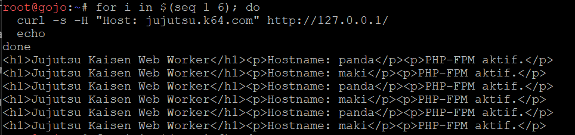  
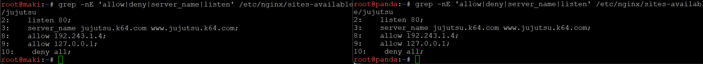  
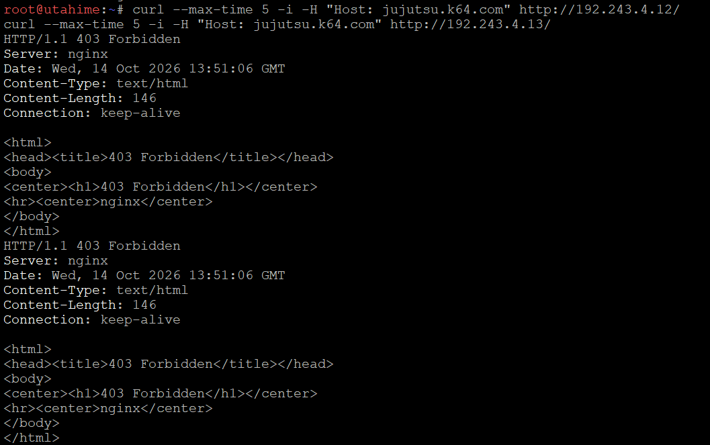  
  
  

---

## Soal 15 — Weighted Round Robin pada Geto

### Penjelasan
Geto menjadi load balancer untuk API. Nanami diberi bobot 3 dan Todo bobot 1, sehingga secara proporsional Nanami menerima sekitar tiga request untuk setiap satu request ke Todo ketika keduanya sehat.

### Konfigurasi
Isi `/etc/nginx/sites-available/api-proxy` di Geto:

```nginx
upstream api_cluster {
    server 192.243.4.14:80 weight=3;
    server 192.243.4.15:80 weight=1;
}

server {
    listen 80;
    server_name api.jujutsu.k64.com;

    location / {
        proxy_pass http://api_cluster;
        proxy_set_header Host api.jujutsu.k64.com;
        proxy_set_header X-Real-IP $remote_addr;
        proxy_set_header X-Forwarded-For $proxy_add_x_forwarded_for;
    }
}
```

`upstream` mendefinisikan kumpulan backend. `weight=3` memberi Nanami bobot tiga kali Todo. `proxy_pass` meneruskan request ke pool backend, sementara header proxy membawa informasi host dan alamat klien.

Validasi dan terapkan:

```bash
nginx -t
service nginx reload
```

### Pengujian dan analisis
Jalankan pengujian dari Geto dengan mengirim 40 request:

```bash
for i in $(seq 1 40); do
    curl -fsS --max-time 5 \
        -H "Host: api.jujutsu.k64.com" \
        "http://127.0.0.1/?test_soal15=$i"
    echo
done | grep -o '"hostname":"[^"]*"' | sort | uniq -c
```

Perintah tersebut mengirim 40 request, mengambil nilai `hostname` dari JSON, lalu menghitung respons tiap worker. Saat kedua worker sehat, jumlah respons Nanami seharusnya kira-kira tiga kali jumlah respons Todo; angka aktual dapat berbeda tergantung kondisi request dan koneksi.

### Dokumentasi
  
  

---

## Soal 16 — Path-Based Routing pada Gojo

### Penjelasan
Gojo menjadi gerbang publik untuk dua jenis layanan. Request root (`/`) diteruskan ke web worker Maki dan Panda dengan Round Robin, sedangkan request `/api` dan `/api/` diteruskan ke Geto untuk diproses oleh API cluster.

### Konfigurasi
Isi `/etc/nginx/sites-available/web-proxy` di Gojo:

```nginx
upstream web_workers {
    server 192.243.4.12:80;
    server 192.243.4.13:80;
}

upstream api_cluster_proxy {
    server 192.243.4.11:80;
}

server {
    listen 80;
    server_name jujutsu.k64.com www.jujutsu.k64.com;

    location = /api {
        proxy_pass http://api_cluster_proxy;
        proxy_set_header Host api.jujutsu.k64.com;
        proxy_set_header X-Real-IP $remote_addr;
        proxy_set_header X-Forwarded-For $proxy_add_x_forwarded_for;
    }

    location /api/ {
        proxy_pass http://api_cluster_proxy;
        proxy_set_header Host api.jujutsu.k64.com;
        proxy_set_header X-Real-IP $remote_addr;
        proxy_set_header X-Forwarded-For $proxy_add_x_forwarded_for;
    }

    location / {
        proxy_pass http://web_workers;
        proxy_set_header Host $host;
        proxy_set_header X-Real-IP $remote_addr;
        proxy_set_header X-Forwarded-For $proxy_add_x_forwarded_for;
    }
}
```

Blok `location = /api` menangani path `/api` secara tepat, sedangkan `location /api/` menangani path di bawahnya. Blok `location /` menjadi rute umum untuk layanan web. Header `X-Real-IP` dan `X-Forwarded-For` diteruskan agar alamat klien dapat dipertahankan sepanjang jalur proxy.

Terapkan konfigurasi:

```bash
nginx -t
service nginx reload
```

### Pengujian dan analisis
Dari klien Network 2 atau Network 3, akses domain utama dan endpoint API:

```bash
curl -H "Host: jujutsu.k64.com" http://192.243.1.4/
curl -H "Host: www.jujutsu.k64.com" http://192.243.1.4/
curl -H "Host: jujutsu.k64.com" http://192.243.1.4/api
```

Request root harus menampilkan hostname Maki atau Panda. Request `/api` harus menghasilkan respons JSON dari API worker (Nanami atau Todo pada kondisi normal). Ini membuktikan routing berdasarkan path berjalan.

### Dokumentasi
  
  

---

## Soal 17 — Meneruskan dan Mencatat IP Asli Klien

### Penjelasan
Saat request melewati beberapa reverse proxy, `REMOTE_ADDR` pada backend biasanya menunjukkan alamat proxy terdekat, bukan alamat klien awal. Pada soal ini, Gojo meneruskan IP melalui `X-Real-IP` dan `X-Forwarded-For`, Geto hanya mempercayai header dari Gojo, dan API worker menggunakan header tersebut hanya jika koneksi memang berasal dari Geto.

### Konfigurasi Gojo
Pada konfigurasi `web-proxy`, Gojo meneruskan alamat klien:

```nginx
proxy_set_header X-Real-IP $remote_addr;
proxy_set_header X-Forwarded-For $proxy_add_x_forwarded_for;
```

`X-Real-IP` membawa IP klien yang dilihat Gojo, sedangkan `X-Forwarded-For` menyimpan rantai IP yang melewati proxy.

### Konfigurasi Geto
Pada `/etc/nginx/sites-available/api-proxy`:

```nginx
set_real_ip_from 192.243.1.4;
real_ip_header X-Forwarded-For;
real_ip_recursive on;
```

`set_real_ip_from` menetapkan Gojo (`192.243.1.4`) sebagai proxy tepercaya. Geto hanya memproses header IP dari sumber tepercaya, sehingga klien tidak bisa sembarangan menentukan alamat yang akan dipercaya.

### Konfigurasi API worker
Pada Nanami dan Todo, API memeriksa apakah koneksi berasal dari Geto sebelum menggunakan `X-Real-IP`:

```php
$proxyIp = $_SERVER['REMOTE_ADDR'] ?? '';
$clientIp = ($proxyIp === '192.243.4.11')
    ? ($_SERVER['HTTP_X_REAL_IP'] ?? $proxyIp)
    : $proxyIp;
```

Jika alamat peer adalah Geto, API menggunakan `HTTP_X_REAL_IP`. Jika bukan, API memakai alamat peer langsung. Nilai `$clientIp` kemudian disimpan ke kolom `client_ip` pada tabel `request_logs`.

### Pengujian dan analisis
Kirim request ke Gojo dari klien Network 2 dan Network 3, lalu periksa data di Yaga:

```sql
SELECT id, client_ip, request_path, status_code, created_at
FROM db_shibuya_k64.request_logs
ORDER BY id DESC
LIMIT 20;
```

Kolom `client_ip` harus berisi IP klien asal yang membuat request, bukan IP Gojo atau Geto. Ulangi dari klien pada subnet berbeda untuk membuktikan alamat asal yang tercatat berubah sesuai klien.

### Dokumentasi
  
  
  

---

## Soal 18 — Kirara sebagai Backup API Worker

### Penjelasan
Nanami dan Todo menjadi worker utama, sementara Kirara disiapkan sebagai worker cadangan. Geto menggunakan passive health check: jika worker utama gagal beberapa kali, Nginx akan menghindari worker tersebut untuk sementara dan mengirim request ke Kirara.

### Konfigurasi Geto
Konfigurasi `upstream` pada `/etc/nginx/sites-available/api-proxy`:

```nginx
upstream api_cluster {
    server 192.243.4.14:80 weight=3 max_fails=2 fail_timeout=5s;
    server 192.243.4.15:80 weight=1 max_fails=2 fail_timeout=5s;
    server 192.243.4.16:80 backup;
}
```

- Nanami dan Todo adalah backend utama.
- `max_fails=2` menetapkan jumlah kegagalan yang ditoleransi sebelum backend dianggap tidak tersedia.
- `fail_timeout=5s` menjadi periode penilaian kegagalan dan penonaktifan sementara.
- `backup` membuat Kirara hanya digunakan ketika backend utama tidak tersedia.

Konfigurasi juga meneruskan header IP dan mengatur timeout:

```nginx
proxy_connect_timeout 2s;
proxy_read_timeout 5s;
proxy_next_upstream error timeout http_500 http_502 http_503 http_504;
```

Opsi `proxy_next_upstream` mengizinkan Nginx mencoba backend lain ketika terjadi error koneksi, timeout, atau status HTTP tertentu.

Validasi dan terapkan di Geto:

```bash
nginx -t
service nginx reload
```

### Konfigurasi Kirara
Kirara menjalankan API yang kompatibel dengan worker lain: menerima request, menghasilkan JSON berisi hostname, dan mencatat request ke tabel `request_logs` di Yaga. Nginx pada Kirara membatasi akses hanya dari Geto:

```nginx
server {
    listen 80;
    server_name api.jujutsu.k64.com;
    root /var/www/api;
    index index.php;

    allow 192.243.4.11;
    deny all;

    location / {
        try_files $uri $uri/ /index.php?$query_string;
    }

    location ~ \.php$ {
        include snippets/fastcgi-php.conf;
        fastcgi_pass unix:/run/php/php8.4-fpm.sock;
    }
}
```

### Pengujian dan analisis
Pertama, akses API melalui Gojo/Geto ketika worker utama aktif. Respons normal akan menampilkan hostname Nanami atau Todo. Selanjutnya, hentikan layanan API/Nginx pada worker utama sebagai simulasi kegagalan, lalu kirim request API melalui jalur proxy yang sama:

```bash
curl -H "Host: api.jujutsu.k64.com" http://192.243.1.4/api
```

Saat Nanami dan Todo tidak dapat melayani request, respons seharusnya berasal dari Kirara dan tidak menghasilkan `502 Bad Gateway`. Periksa juga tabel `request_logs` di Yaga untuk memastikan request cadangan tercatat.

### Dokumentasi
  
  

## Soal 19 — Nginx Proxy Caching dan Rate Limiting pada Gojo

### Tujuan

Menerapkan cache untuk halaman frontend selama **10 menit**, menambahkan header **`X-Cache-Status`**, serta menerapkan batas **10 request/detik per IP** pada endpoint `/api`.

### Implementasi

Gojo menjalankan Nginx sebagai reverse proxy. Lokasi `/` diarahkan ke backend frontend Maki dan Panda, sedangkan `/api` diteruskan menuju Geto. Header IP asli klien (`X-Real-IP`, `X-Forwarded-For`) tetap diteruskan. Konfigurasi Soal 19 disimpan dalam `/root/soal_19.sh`.

Potongan konfigurasi yang diterapkan:

```nginx
# Konteks http:
proxy_cache_path /var/cache/nginx/jujutsu levels=1:2
                 keys_zone=jujutsu_cache:10m max_size=100m
                 inactive=10m use_temp_path=off;
limit_req_zone $binary_remote_addr zone=api_limit:10m rate=10r/s;

# Lokasi /api:
limit_req zone=api_limit burst=5 nodelay;
limit_req_status 429;

# Lokasi /:
proxy_cache jujutsu_cache;
proxy_cache_valid 200 10m;
proxy_cache_lock on;
add_header X-Cache-Status $upstream_cache_status always;
```

### Pengujian dan hasil

Pengujian dilakukan dengan URL baru agar cache belum terisi. Tiga request ke URL yang sama menghasilkan:

| Request | Status HTTP | Header `X-Cache-Status` |
|---|---|---|
| Pertama | 200 | `MISS` |
| Kedua | 200 | `HIT` |
| Ketiga | 200 | `HIT` |

Endpoint `/api` diuji dalam keadaan normal dan merespons HTTP 200 dari worker API. Selanjutnya, **50 request paralel** digunakan untuk mengamati rate limit. Hasilnya adalah **7 respons HTTP 200** dan **43 respons HTTP 429**.


*Gambar 19.1. Script Soal 19 berhasil diterapkan dan `nginx -t` valid.*


*Gambar 19.2. Respons pertama mengambil konten dari upstream (MISS), sedangkan request berikutnya menggunakan cache (HIT).*


*Gambar 19.3. API berhasil melayani request normal; request beruntun yang melebihi batas ditolak HTTP 429.*

**Kesimpulan:** Proxy caching dengan masa berlaku 10 menit dan rate limiting sebesar 10 request/detik/IP berhasil dikonfigurasi dan terbukti melalui pengujian.

---

## Soal 20 — Audit Performa Web dan API Menggunakan Apache Benchmark

### Tujuan

Menguji kapasitas layanan menggunakan Apache Benchmark (`ab`) dari Kusakabe, dengan total **600 request** dan tingkat konkurensi **30**. Pengujian mencakup halaman frontend serta API pada kondisi rate limit **OFF** dan **ON**. Access log Gojo digunakan untuk membedakan penolakan kebijakan (HTTP 429) dari kegagalan aplikasi/koneksi.

### Implementasi

Apache Benchmark dipasang pada klien Alpine Kusakabe menggunakan `apk add apache2-utils`. Domain `jujutsu.k64.com` sementara dipetakan ke IP Gojo `192.243.1.4` melalui `/etc/hosts` ketika server DNS sedang tidak tersedia, sehingga pengujian masih memakai nama host yang sama. Pemetaannya hanya untuk keperluan akses host pada pengujian Soal 20, bukan bukti bahwa DNS Master–Slave telah hidup kembali setelah restart. Hasil disimpan dalam `/root/soal_20_web.txt`, `/root/soal_20_api_off.txt`, dan `/root/soal_20_api_on.txt`; otomatisasi perintah tersimpan sebagai `/root/soal_20.sh`.

```bash
ab -l -n 600 -c 30 http://jujutsu.k64.com/
# Saat rate limiting dinonaktifkan sementara pada Gojo:
ab -l -n 600 -c 30 'http://jujutsu.k64.com/api?soal20=off'
# Setelah rate limiting Gojo diaktifkan kembali:
ab -l -n 600 -c 30 'http://jujutsu.k64.com/api?soal20=on'
```

Pembatasan request hanya dinonaktifkan selama pengambilan baseline. Setelah baseline selesai, konfigurasi aktif Soal 19 dikembalikan dan `nginx -t` serta reload berhasil.

### Hasil benchmark

| Metrik | Frontend `/` | API rate limit OFF | API rate limit ON |
|---|---:|---:|---:|
| Jumlah request | 600 | 600 | 600 |
| Concurrency | 30 | 30 | 30 |
| Requests per second | **4963,72** | **451,80** | **3851,51** |
| Time per request (mean) | **6,044 ms** | **66,401 ms** | **7,789 ms** |
| P95 latensi | **8 ms** | **117 ms** | **9 ms** |
| Failed requests (`ab`) | **0** | **0** | **0** |
| Non-2xx responses | tidak tercatat | tidak tercatat | **593** |
| Respons HTTP 200 dari log Gojo | — | **600** | **7** |
| Respons HTTP 429 dari log Gojo | — | **0** | **593** |

Angka *Requests per second* pada API rate limit ON terlihat lebih besar dibandingkan OFF, **bukan berarti backend API memproses lebih banyak request berhasil**. Sebagian besar request ditolak lebih cepat oleh Nginx dengan HTTP 429 tanpa diteruskan ke backend. `Failed requests: 0` merupakan indikator kegagalan menurut ApacheBench, sedangkan **593 respons HTTP 429** tercatat sebagai `Non-2xx responses`; keduanya tidak bertentangan.


*Gambar 20.1. Benchmark 600 request, concurrency 30, RPS 4963,72, latensi mean 6,044 ms, dan failed requests 0.*


*Gambar 20.2. RPS 451,80 dan latensi mean 66,401 ms ketika seluruh request diterima backend.*


*Gambar 20.3. RPS 3851,51, latensi mean 7,789 ms, dan 593 respons Non-2xx.*


*Gambar 20.4. Tanpa rate limit terdapat 600 respons 200; dengan rate limit terdapat 7 respons 200 dan 593 respons 429, dan aturan limit telah aktif kembali.*

### Analisis kegagalan

Dari akses log pengujian API, tidak ditemukan respons HTTP 500, 502, atau 504 pada request yang diberi penanda `soal20=off` dan `soal20=on`. Semua 593 respons Non-2xx yang tercatat pada pengujian ON berupa **HTTP 429**, sehingga diklasifikasikan sebagai **penolakan oleh kebijakan rate limiting**, bukan kegagalan proses aplikasi atau masalah koneksi upstream pada hasil pengujian ini.

**Kesimpulan:** Apache Benchmark berhasil memberikan metrik kapasitas frontend/API. Pengujian membuktikan bahwa pembatasan 10 request/detik/IP mengurangi request berlebihan yang mencapai API; HTTP 429 muncul sesuai kebijakan dan status layanan Soal 19 dikembalikan setelah pengujian.

---
